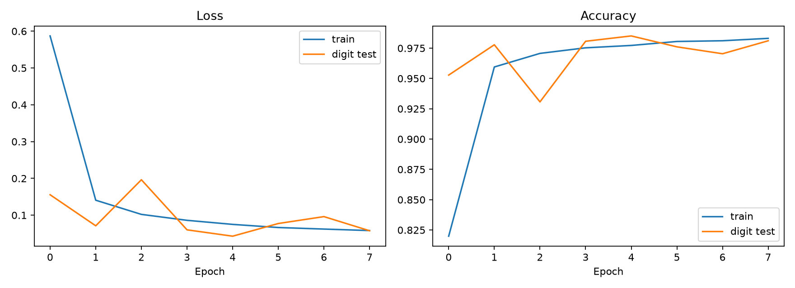
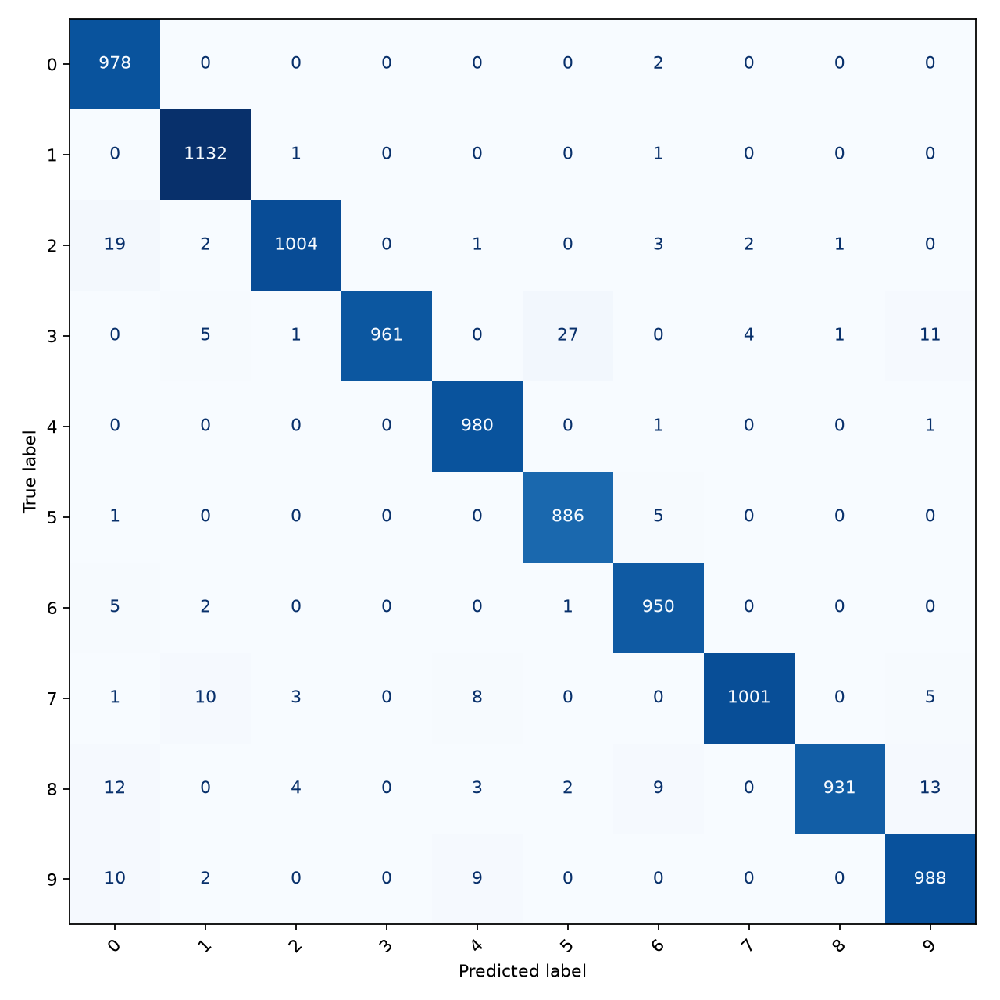
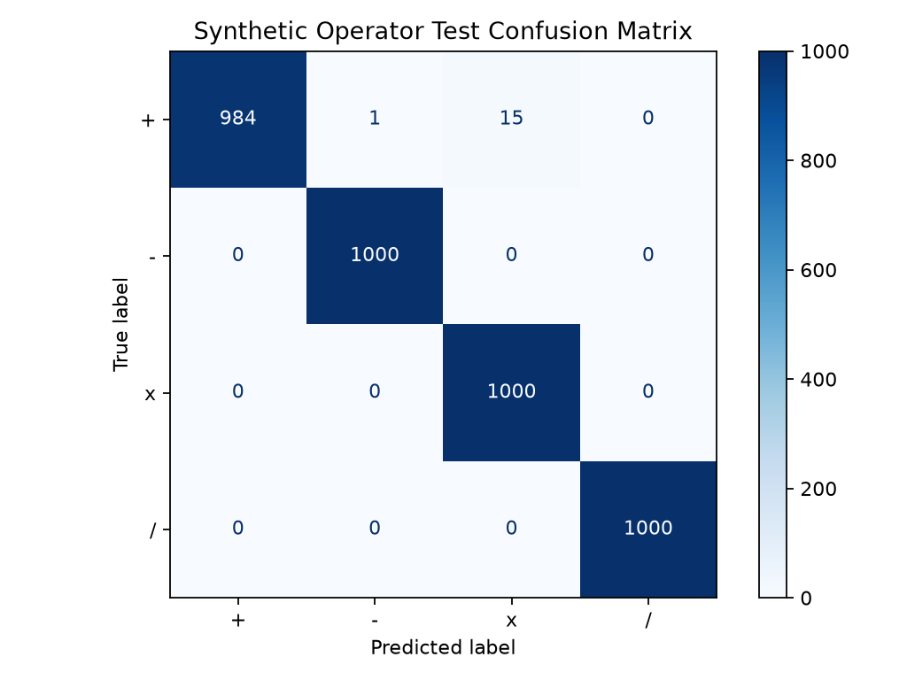
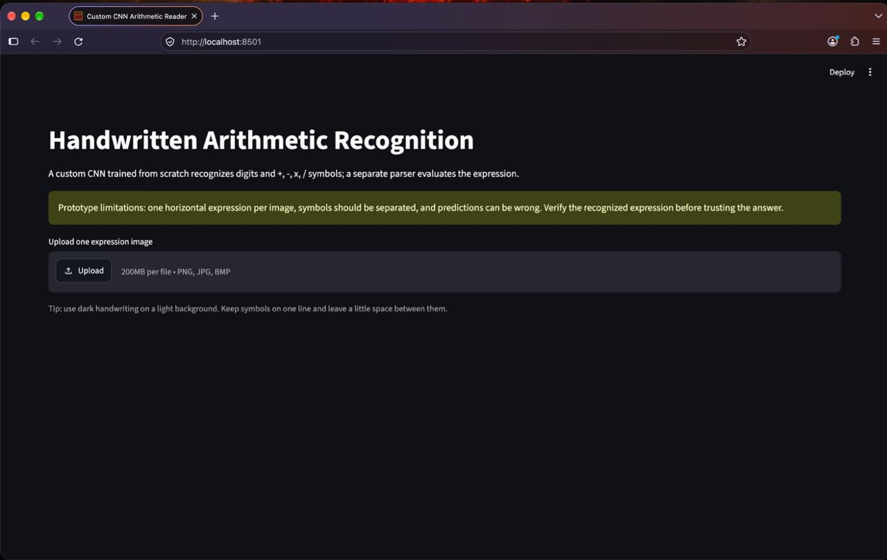
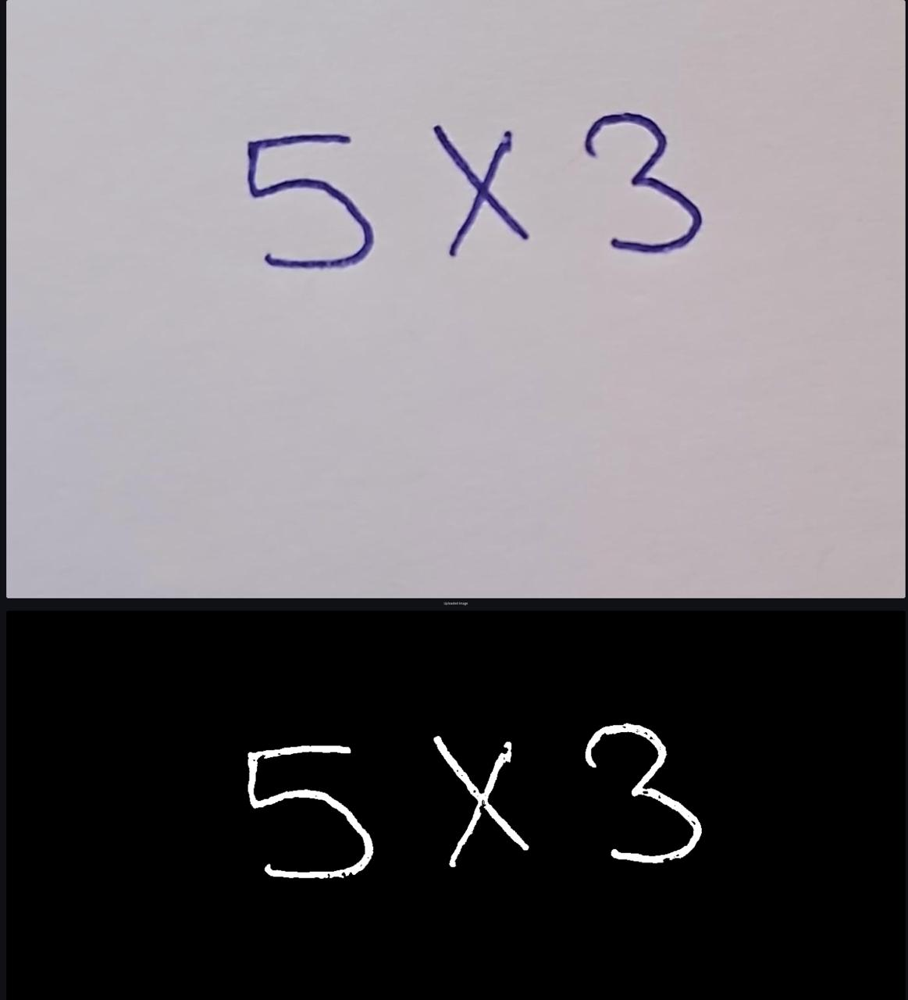
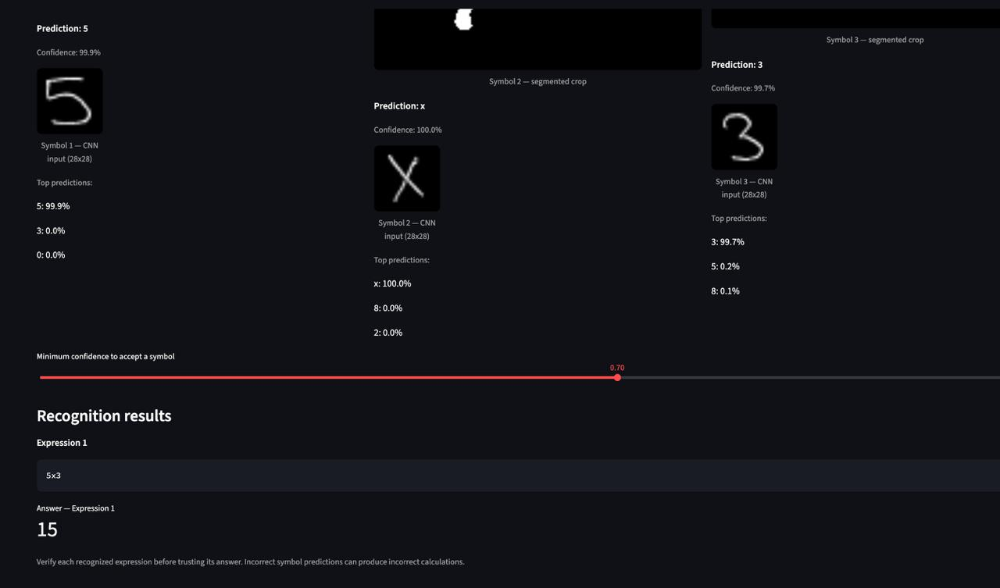
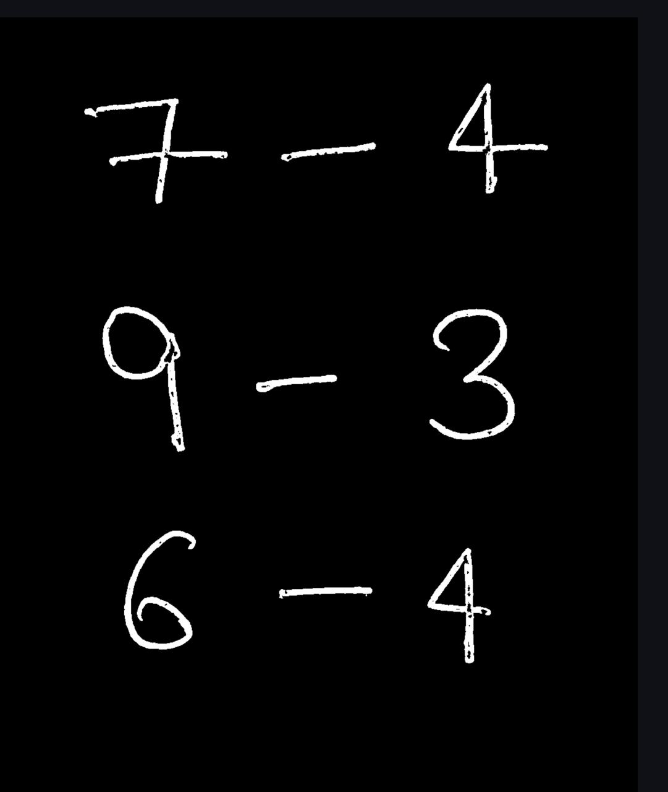

# Handwritten Arithmetic Recognition Using a CNN

A handwritten arithmetic recognition application built using a custom Convolutional Neural Network (CNN) trained from scratch with PyTorch. The application processes uploaded images, segments handwritten symbols, predicts digits and arithmetic operators, and evaluates the resulting expressions.

## Features

- Recognizes digits `0–9`.
- Supports addition (`+`), subtraction (`-`), multiplication (`x` or `×`), and division (`/`).
- Processes equations written on separate lines in one image.
- Displays detected symbol crops, predicted labels, and confidence scores.
- Evaluates recognized expressions using a restricted arithmetic parser.
- Handles division-by-zero errors.
- Uses a custom CNN rather than a pretrained recognition model.

## Current Limitations

- Recognition is not guaranteed to be correct. Always verify the predicted expression and answer.
- Faint background writing, stray marks, and poor image quality can affect segmentation.
- Equations written side by side on the same line are not yet reliably supported.
- The conventional division symbol (`÷`) is not reliably supported; use `/`.
- Operator recognition depends on the quality and variety of training examples.
- The application is a prototype and should not be used where incorrect calculations could cause harm.

## Project Structure

```text
handwritten_arithmetic_cnn/
├── app.py
├── model.py
├── train.py
├── train_handwritten_x.py
├── train_real_operators.py
├── evaluate_digits.py
├── evaluate_handwriting.py
├── evaluate_operators.py
├── make_samples.py
├── requirements.txt
├── README.md
├── artifacts/
│   ├── arithmetic_cnn.pt
│   ├── arithmetic_cnn_handwritten_x.pt
│   └── evaluation reports and plots
└── backups/
```

## Requirements

Python 3.10 or 3.11 is recommended. Install the packages listed in `requirements.txt`.

### macOS / Linux

```bash
python3 -m venv .venv
source .venv/bin/activate
python -m pip install --upgrade pip
pip install -r requirements.txt
```

### Windows PowerShell

```powershell
py -m venv .venv
.venv\Scripts\Activate.ps1
python -m pip install --upgrade pip
pip install -r requirements.txt
```

## Run the Application

From the project directory, activate your virtual environment and run:

```bash
streamlit run app.py
```

Open the local URL displayed in the terminal, then upload a clear image containing handwritten arithmetic equations. For best results, use dark writing on clean, light paper, with symbols separated clearly and each equation written on its own line.

The application displays symbol predictions, confidence information, recognized expressions, and calculated results. Check the predictions before relying on the answers.

## Train the Model

To train the base CNN from scratch:

```bash
python train.py --epochs 8 --batch-size 128
```

The training script uses MNIST for digit data and generates operator examples using locally installed fonts. The model and evaluation artifacts are saved under `artifacts/`.

A quick pipeline test can be run with:

```bash
python train.py --epochs 1 --batch-size 128 --limit 12000
```

A one-epoch run is only a smoke test, not a suitable final training result.

**Important:** Training again may overwrite the base checkpoint. Back up any checkpoint you want to preserve before retraining.

## Evaluation

The repository includes scripts for evaluating digit recognition, handwriting predictions, and operator recognition:

- `evaluate_digits.py`
- `evaluate_handwriting.py`
- `evaluate_operators.py`

Evaluation reports and plots are stored in `artifacts/`. Report measured results from the actual evaluation outputs; do not treat expected results as measured accuracy.

Useful evaluation measures include:

- Digit classification accuracy
- Operator classification accuracy
- Symbol recognition accuracy
- Complete-expression accuracy
- Arithmetic answer accuracy

## Troubleshooting and Known Issues

- **Incorrect symbols:** Verify the displayed crops and confidence scores.
- **Missing minus signs or extra marks:** Image thresholding and contour filtering can affect thin operators and background noise.
- **Incorrect expression:** Check whether segmentation and symbol predictions are correct before investigating arithmetic parsing.
- **Model loading errors:** Verify that the expected checkpoint exists in `artifacts/` and matches the architecture in `model.py`.

## Future Improvements

- Improve background-noise suppression while preserving thin operators.
- Support multiple equations written side by side on one line.
- Expand the real handwritten operator dataset.
- Evaluate on a fixed, independent test set with samples from multiple writers.
- Improve robustness to different handwriting styles, image sizes, and lighting conditions.

## Technologies

- Python
- PyTorch
- OpenCV
- Streamlit
- NumPy
- Torchvision

## Model Performance

The custom CNN was evaluated separately for handwritten digit classification and arithmetic-operator classification.

### Digit Classification

Evaluated on 10,000 test samples covering digits 0–9.

| Metric | Score |
|---|---:|
| Micro Precision | 98% |
| Micro Recall | 98% |
| Micro F1-score | 98% |
| Macro Precision | 98% |
| Macro Recall | 98% |
| Macro F1-score | 98% |
| Weighted F1-score | 98% |

*Scores are reported at the precision shown in the classification report.*

### Arithmetic-Operator Classification

Evaluated on 4,000 test samples, with 1,000 samples per operator.

| Metric | Score |
|---|---:|
| Accuracy | 99.60% |
| Macro Precision | 99.61% |
| Macro Recall | 99.60% |
| Macro F1-score | 99.60% |
| Weighted F1-score | 99.61% |

The evaluated operators are addition (`+`), subtraction (`-`), multiplication (`x`), and division (`/`).

### Evaluation Visualizations

The `artifacts/` directory contains the classification reports, confusion matrices, training curves, and sample visualizations used to inspect model performance.

**Note:** These results measure individual symbol classification. They should not be interpreted as complete handwritten-expression recognition accuracy or end-to-end arithmetic-solving accuracy.

### Training Curves



### Digit Confusion Matrix



### Operator Confusion Matrix



## Workflow

1. **Upload Image:** Upload an image containing a handwritten arithmetic expression through the Streamlit interface.
2. **Image Preprocessing:** Use OpenCV to prepare the image for symbol recognition.
3. **Symbol Segmentation:** Separate individual digits and arithmetic operators from the handwritten expression.
4. **CNN Classification:** Use the trained digit and operator CNN models to predict the symbols.
5. **Expression Reconstruction:** Combine the predicted symbols to form the arithmetic expression.
6. **Result Calculation:** Evaluate the reconstructed expression and display the calculated result.
7. **Prediction Visualization:** Display the recognition results and symbol-level confidence scores in the application.


### 1. Application Interface



### 2. Single Expression Recognition

| Input Image | Recognition Output |
|---|---|
|  |  |

**Example:** `5 × 3 = 15`

### 3. Vertical Expression Recognition

| Input Image | Recognition Output |
|---|---|
|  |  |

**Examples:**
- `7 − 4 = 3`
- `9 − 3 = 6`
- `6 − 4 = 2`

